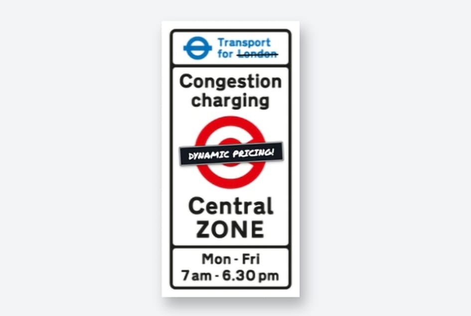

# Dynamic congestion pricing for London: **Central Zone**

A dynamic charge could help minimise congestion, reduce pollution and keep costs down for drivers, but it needs to know what the next few hours will look like. This project forecasts congestion, NO₂ and PM₂.₅ 1, 3 and 6 hours ahead using machine learning, tests the forecasts on unseen data, and uses a multi-objective optimiser to test whether those forecasts can support dynamic road pricing.

**Live dashboard: [london-congestion-pricing.streamlit.app](https://london-congestion-pricing.streamlit.app)**
---
**The question**
London's Congestion Charge is one flat daily fee, but traffic and air quality change hour by hour. Could an hourly charge, published in advance from forecasts, reduce congestion and air pollution while keeping costs reasonable for drivers?
---
**The answer**
Congestion can be forecast well up to 6 hours ahead (33% to 48% fewer errors than the best simple rule). NO₂ and PM₂.₅ forecasts barely beat simple rules.
Changing the price hour by hour helps only a little. At the same £15 average price, hourly pricing changes congestion by about -0.4%. Raising the flat charge to £18 changes it by about -20%. The price level is the strong lever; hourly timing is weak.
A simple weekly-average forecast prices as well as the machine learning model. The forecast is sufficient for pricing, but not shown to be necessary.
---
Driver response to price is assumed, not measured, so the pricing results are scenarios, not predictions.

Show Image

Results against the success criteria

The criteria were written before any modelling (docs/02). Forecasts were scored once on unseen months (May and June 2025). Every number below comes from reports/tables.

Forecasting (RQ1)
Criterion	Result	Pass?
S1 At least 10% fewer errors than the best simple rule	Congestion: 47.5% (1h), 43.7% (3h), 33.1% (6h). NO₂: 2.6%, 9.6%, 6.1%. PM₂.₅: 4.7%, 1.1%, -3.1%	Congestion only (3 of 9)
S2 No month worse than 1.5 times the average error	All pass except PM₂.₅ at 3h (1.50) and 6h (1.76)	7 of 9
S3 Congestion alarm at 6h: recall 0.80 or more, precision 0.85 or more	Recall 0.81, precision 0.98	Pass (narrow)
S4 Average bias under 10% of the level	Fails for congestion 6h (10.7%), NO₂ 6h (28.6%), PM₂.₅ 3h (11.2%) and 6h (18.0%)	5 of 9

Average error (MAE) of the model against the best simple rule:

Target	1h ahead	3h ahead	6h ahead
Congestion	4.12 vs 7.84	5.29 vs 9.40	6.28 vs 9.39
NO₂ (µg/m³)	4.48 vs 4.60	6.45 vs 7.13	9.05 vs 9.64
PM₂.₅ (µg/m³)	2.69 vs 2.83	3.42 vs 3.45	4.15 vs 4.03

Congestion is the TomTom congestion level: extra travel time compared with free flow, in percent. Its errors are in percentage points.

Pricing (RQ2) and robustness (RQ3)
Criterion	Result	Pass?
S5 Hourly pricing beats a flat charge at the same average price	Gain 0.0012 (95% range 0.0010 to 0.0014) at moderate response. Small but above zero	Pass (small)
S6 Congestion, NO₂, PM₂.₅, driver cost and revenue reported for every plan	pricing_summary.csv and the dashboard	Pass
S7 Advantage survives forecast error at twice the measured level	Positive at 1.5 times, gone at 2 times (break-even about 1.8 times)	Narrow fail
S8 Best schedule stable across driver response (-0.1, -0.3, -0.5)	Same shape at all three: cheapest 07:00, dearest 11:00	Pass
S9 Forecast necessary, not just sufficient	Weekly-average forecast gives the same gain as the model (0.0012)	Sufficient, not shown necessary

At moderate driver response (elasticity -0.3), compared with today's flat £15:

Plan	Average price	Congestion	NO₂	PM₂.₅	Revenue
Hourly, from our forecast	£15	-0.44%	+0.02%	+0.06%	+0.05%
Hourly, perfect foresight	£15	-0.49%	+0.02%	+0.02%	+0.05%
Flat £18	£18	-19.7%	-1.0%	-2.5%	+13.6%

Honest notes:

The S5 yardstick was changed after the first optimiser runs, from a spread across five random seeds to a 95% range from resampling the 40 test days, because the final optimiser (SLSQP) has no random seed.
TfL raised the standard charge from £15 to £18 on 2 January 2026. The data covers 2025, so £15 is the base here. The flat £18 scenario is the size of that rise, but driver response is assumed, so it is not a prediction of what happened.
Method in brief
Data: hourly, 1 January to 30 June 2025 (4,343 hours). Congestion for Westminster (central) and the City of London (neighbour). Air quality from roadside sites WM6 (Oxford Street, the target), CE2 and MY1. Weather for central London.
Split: train to 30 April 2025, test May and June, scored once. Settings were tuned on validation months (March and April) only.
Baselines: persistence (value now) and weekly profile (average for that weekday and hour). Every model must beat the better of the two.
Models: ridge, random forest and XGBoost, either predicting directly or correcting the simple rule. One model per target and horizon (1, 3 and 6 hours).
Pricing simulation: weekday prices published at 07:00 (for 07:00 to 12:00) and 13:00 (for 13:00 to 17:00), between £10 and £18, with an £18 daily cap. Driver response is a constant elasticity of -0.1, -0.3 or -0.5. Traffic turns into delay through the standard BPR road curve (alpha 0.15, exponent 4). Pollution changes only through the measured traffic share (NO₂ 0.19, PM₂.₅ 0.47 upper bound). A standard solver (SLSQP) sets the headline schedules; NSGA-II maps the trade-off set.
Monitoring: drift checks (PSI and KS) and a week-by-week replay of May and June. The replay would have flagged the 6-hour pollution forecasts for retraining from the first week, and congestion at 6 hours from early June, all because of bias rather than lost accuracy.
How to run it

Tested with Python 3.13 on Windows.

1. What anyone can run (no data needed)
git clone https://github.com/lamide-akanni/london-dynamic-congestion-pricing.git
cd london-dynamic-congestion-pricing
python -m venv .venv
.venv\Scripts\activate
pip install -r requirements-lock.txt
pip install -e .
python -m pytest -q
streamlit run app/streamlit_app.py

On macOS or Linux, activate with source .venv/bin/activate. The tests and the dashboard use only the saved results, tables and models in the repo.

2. The full pipeline (needs the data)

The raw data is not in the repo.

Traffic: download the London file from TomTom Traffic Index downloads (January to June 2025, Westminster and City of London) and save it as data/raw/tomtom_london_2025H1.csv.
Air quality and weather: downloaded automatically by the first command below.
python run_all.py --download

This cleans the data, runs the data checks, trains the final models and makes a forecast, writing a log to logs/. It takes about a minute (plus the download). Later runs can skip the download: python run_all.py.

The analysis steps (baselines, tuning, scoring, pricing, robustness, monitoring) are the numbered scripts in scripts/, run in order, for example python scripts/10_final_score.py.

Results reproduce exactly on the author's machine. On another operating system XGBoost scores move by about 0.1 MAE; no pass or fail result changes.

Repository map
Folder	What is in it
app/	Streamlit dashboard
src/ccz/	Reusable code: settings (config.py), features, baselines, models, pricing, optimiser, inference, data checks, logging
scripts/00 to 03	Download, clean, and join the data
scripts/04 to 13	EDA, baselines, models, tuning, final score, error analysis, explanation
scripts/14 to 24	Pricing inputs, simulation, optimiser, robustness, Pareto set, extra checks
scripts/25 to 27	Train final models, batch forecast, monitoring
run_all.py	One command from raw data to saved models
models/	Trained models and their manifest
reports/	Result tables and figures
docs/	Problem, research questions, data dictionaries, cleaning rules, EDA findings
tests/	Automated tests
Data and credits
Traffic: TomTom Traffic Index. © TomTom. Used for research; the TomTom data is not redistributed in this repository.
Air quality: London Air Quality Network (LAQN), Environmental Research Group, Imperial College London.
Weather: Weather data by Open-Meteo.com, licensed under CC BY 4.0. Historical weather is based on reanalysis data from the Copernicus Climate Change Service (C3S).
Congestion Charge amounts: Transport for London.
Limits
Six months of data, so seasons are not fully covered.
Congestion is measured for whole boroughs, not the exact charging zone.
Driver response to price is assumed, in three scenarios.
NO₂ and PM₂.₅ depend on weather and background pollution, not only traffic.
Traffic pushed outside the zone, and who pays, are not modelled.
Whether LAQN hourly times mark the start or the end of the hour is not yet confirmed. Times were not shifted.
What this project does not claim
That dynamic road pricing works in reality.
That driver response to price was measured.
That machine learning improved the pricing decision (S9 says it was sufficient, not shown necessary).
That the results should be implemented.

This is an independent research project by lamide-akanni. It is not affiliated with TfL.

Licence

Code: MIT licence (see LICENSE). The licence covers the code only, not the data.
